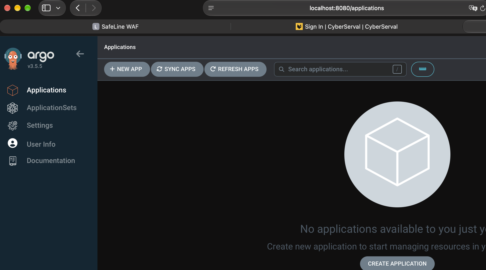
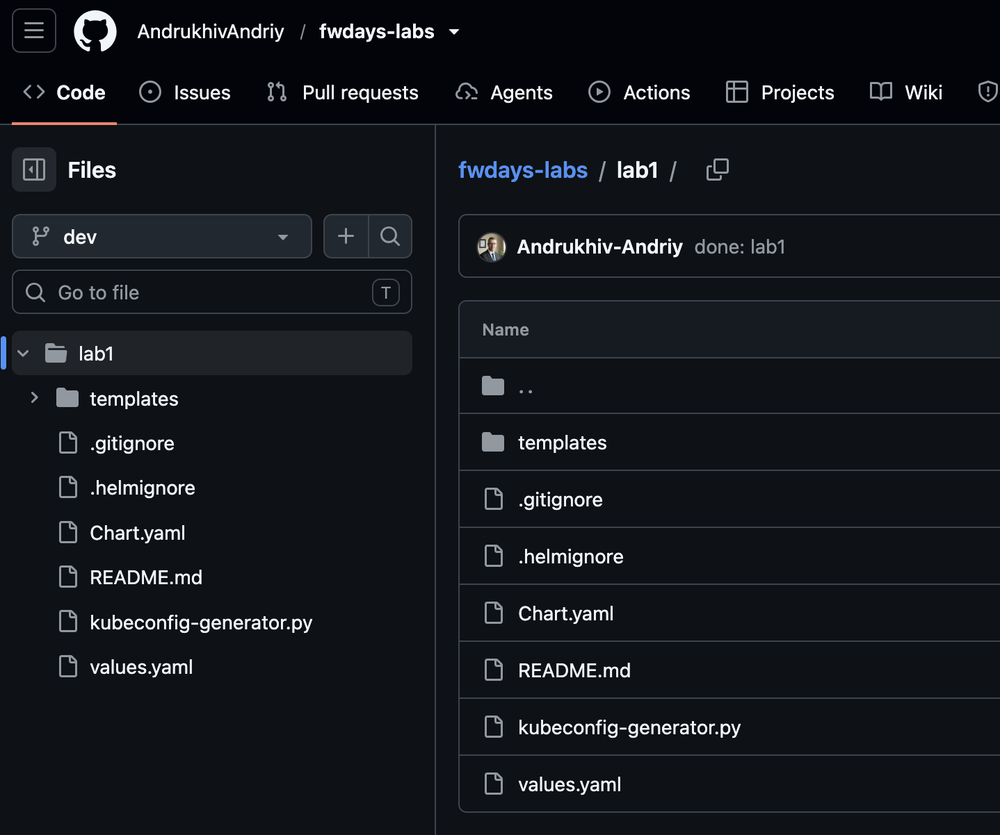
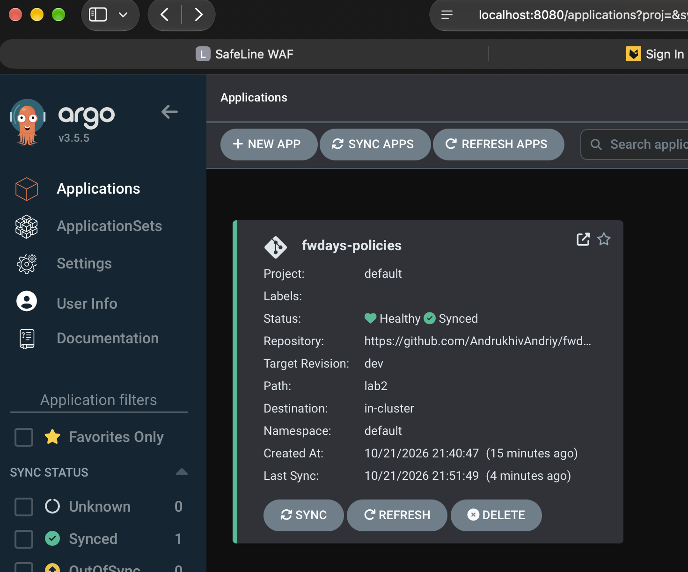

# Module 03 — Platform Engineering: GitOps + Helm + Kyverno

> **Результат: виконано.** Kyverno-політики описані окремим Helm chart, а їхнім бажаним станом керує Argo CD з Git-репозиторію. Підтверджений фінальний стан Application: **Healthy / Synced**.

## 1. Мета та виконання завдання

| Вимога | Реалізація | Результат |
| --- | --- | --- |
| Налаштувати GitOps-систему (Argo CD або Flux) | Встановлено **Argo CD v3.5.5** в Kubernetes | ✅ |
| Керувати конфігурацією через Git | Публічний GitHub-репозиторій `AndrukhivAndriy/fwdays-labs`, гілка `dev` | ✅ |
| Переписати Kyverno policies у Helm chart | Окремий chart `lab2/`, параметризовані шаблони та `values.yaml` | ✅ |
| Підключити chart до GitOps | Argo CD Application `fwdays-policies`, джерело `lab2` | ✅ |
| Перевірити результат | Обидві політики `Ready=True`; Application `Synced / Healthy` | ✅ |

## 2. Архітектура

```text
GitHub: AndrukhivAndriy/fwdays-labs (branch: dev)
                    │
                    ▼
           Argo CD Application
             fwdays-policies
                    │
                    ▼
            Helm chart: lab2/
                    │
          ┌─────────┴─────────┐
          ▼                   ▼
   Mutation Policy      Validation Policy
   person label         readonlyRootfs (Audit)
          └─────────┬─────────┘
                    ▼
              Kyverno / k3s
```

Argo CD відстежує Git як джерело бажаного стану, рендерить Helm chart і застосовує Kubernetes-ресурси. Для Application налаштовано `automated`, `prune: true`, `selfHeal: true`. Це **підтверджує конфігурацію** автоматичної синхронізації; окремий експеримент із навмисним drift/self-heal не проводився.

## 3. Структура проєкту

```text
fwdays-labs/
├── lab1/                         # Module 02: namespaces, ServiceAccounts, RBAC
└── lab2/                         # Module 03: GitOps для Kyverno policies
    ├── Chart.yaml
    ├── values.yaml
    ├── .helmignore
    ├── templates/
    │   ├── kyverno-mutation.yaml
    │   └── kyverno-validation.yaml
    ├── argocd/
    │   └── application.yaml
    ├── screenshots/
    │   ├── argocd-before-application.png
    │   ├── argocd-synced-healthy.png
    │   └── github-lab1-dev.png
    └── README.md
```

`lab1` і `lab2` використовують **різні імена Kyverno policies**, тому новий Argo CD Application не перебирає на себе ресурси, що належать старому Helm release `learning-lab`. Цей release видаляти не потрібно: він керує namespaces та RBAC.

## 4. Helm chart: політики

### 4.1. Mutation — `fwdays-policies-person-label`

Для Pod у namespace з міткою `person-role=student` автоматично додається `person=student`; для `person-role=mentor` — `person=mentor`. Використано `namespaceSelector`, тому правила не залежать від конкретних імен студентів чи namespaces.

### 4.2. Validation — `fwdays-policies-readonly-rootfs`

Для Pod у namespaces з `person-role=student` або `person-role=mentor` перевіряється `securityContext.readOnlyRootFilesystem: true` у звичайних та init-контейнерах. Режим **Audit**: порушення реєструються, але створення Pod не блокується.

Обидві політики використовують API `kyverno.io/v1`, тип `ClusterPolicy`. У шаблонах явно задано стандартні поля Kyverno (`admission`, `emitWarning`, `validationFailureAction`, `skipBackgroundRequests`, `allowExistingViolations`), щоб уникнути постійного `OutOfSync` після нормалізації ресурсів контролером.

> **Обмеження:** ці дві політики не забороняють вручну встановлювати мітку `person` у сторонніх namespaces. Це окрема вимога, яку потрібно реалізовувати додатковою validation policy, якщо вона входить до критеріїв Module 02.

## 5. Підключення до Argo CD

Параметри Application:

| Поле | Значення |
| --- | --- |
| Application | `fwdays-policies` |
| Project | `default` |
| Repository | `https://github.com/AndrukhivAndriy/fwdays-labs.git` |
| Target revision | `dev` |
| Path | `lab2` |
| Helm release name | `fwdays-policies` |
| Destination | `in-cluster`, namespace `default` |
| Sync policy | `automated`, `prune`, `selfHeal` |

Команди для відтворення конфігурації (не потрібно запускати повторно у вже налаштованому кластері):

```bash
helm lint lab2 && helm template fwdays-policies lab2
kubectl apply -f lab2/argocd/application.yaml
kubectl -n argocd get application fwdays-policies
kubectl get clusterpolicy fwdays-policies-person-label fwdays-policies-readonly-rootfs
```

## 6. Реальна перевірка та усунення OutOfSync

Після першого розгортання Application мав стан `OutOfSync / Healthy`, хоча обидва ресурси вже існували й були `Ready=True`.

Перевірка `kubectl -n argocd get application fwdays-policies -o json` показала:

- `operationState.phase: Succeeded`;
- обидві політики успішно застосовано через **Server-Side Apply**;
- `conditions: null`;
- `autoHealAttemptsCount: 5` — Argo CD повторно намагався усунути відмінності.

Огляд фактичного `.spec` показав додаткові стандартні поля Kyverno. Їх явно внесено до Helm templates та відправлено в гілку `dev`. **Після оновлення Application перейшов у `Synced / Healthy`**, що видно на скриншоті нижче.

Підтверджено `Ready=True` для:

```text
fwdays-policies-person-label      Ready=True
fwdays-policies-readonly-rootfs   Ready=True
```

## 7. Скриншоти виконання

### 7.1. Argo CD встановлено — початковий стан

Інтерфейс Argo CD v3.5.5 до створення Application.



### 7.2. GitHub — вихідний Helm chart Module 02

Гілка `dev`, каталог `lab1/` із початковим Helm chart. Це **історичний скриншот Module 02**, а не доказ поточного вмісту `lab2`.



### 7.3. Argo CD — фінальний стан Healthy / Synced

Application `fwdays-policies`: Git revision `dev`, шлях `lab2`, destination `in-cluster`, **Healthy / Synced**.



## 8. Підсумок і технічні зауваження

**Обидві вимоги Module 03 виконані:** GitOps-система налаштована, а Kyverno policies винесені в окремий Helm chart і синхронізуються Argo CD. Підсумковий стан підтверджено командним виводом та скриншотом.

- **Kyverno API:** `ClusterPolicy` (`kyverno.io/v1`) позначено як deprecated. У майбутньому потрібна міграція на `policies.kyverno.io` (`ValidatingPolicy` / `MutatingPolicy`). Це не блокує поточну лабораторну.
- **Межі перевірки:** підтверджено стан `Ready=True` та `Synced / Healthy`; окремий тест Git commit → автоматичний rollout і навмисне порушення self-heal не проводилися.
- **Module 02:** release `learning-lab` залишається окремим власником namespaces, ServiceAccounts і RBAC. Не видаляти його під час роботи з `lab2`.
