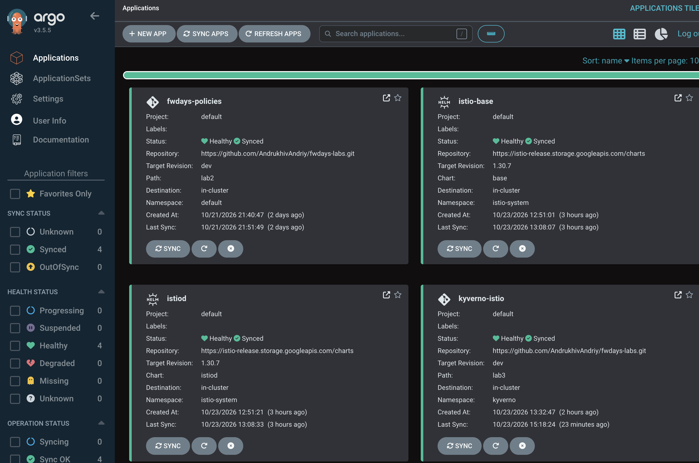

Модуль 04 — Service Mesh (Istio + Kyverno)

Мета

Встановити Istio Service Mesh у режимі Sidecar та налаштувати Kyverno для перевірки наявності Istio Sidecar у студентських Pod.

Виконані роботи

1. Встановлено Istio 1.30.7 через Helm та Argo CD:
    * istio-base — базові компоненти та CRD.
    * istiod — керуючий компонент Service Mesh.
2. Увімкнено автоматичну ін’єкцію Sidecar для просторів імен student01, student02, student03:

kubectl label namespace student01 student02 student03 istio-injection=enabled --overwrite

3. Створено окремий Helm chart із Kyverno ClusterPolicy require-istio-sidecar.
4. Налаштовано розгортання політики через Argo CD Application kyverno-istio.
5. Політика перевіряє наявність istio-proxy з restartPolicy: Always у Pod із міткою person: student. Режим перевірки — Audit.

Результати перевірки

Argo CD

Application	Sync Status	Health Status
fwdays-policies	Synced	Healthy
istio-base	Synced	Healthy
istiod	Synced	Healthy
kyverno-istio	Synced	Healthy

Istio Sidecar

Тестовий Pod student01/istio-test:

* Статус: 2/2 Running.
* Основний контейнер: istio-test.
* Istio Sidecar: istio-proxy (Native Sidecar).
* restartPolicy: Always.

Kyverno

Результат перевірки PolicyReport:

Policy: require-istio-sidecar
Rule:   check-istio-sidecar
Result: PASS

Підсумок

* Istio Service Mesh встановлено та налаштовано.
* Автоматична ін’єкція Sidecar працює.
* Kyverno перевіряє наявність Istio Sidecar у студентських Pod.
* Усі Argo CD Applications мають статус Synced / Healthy.
