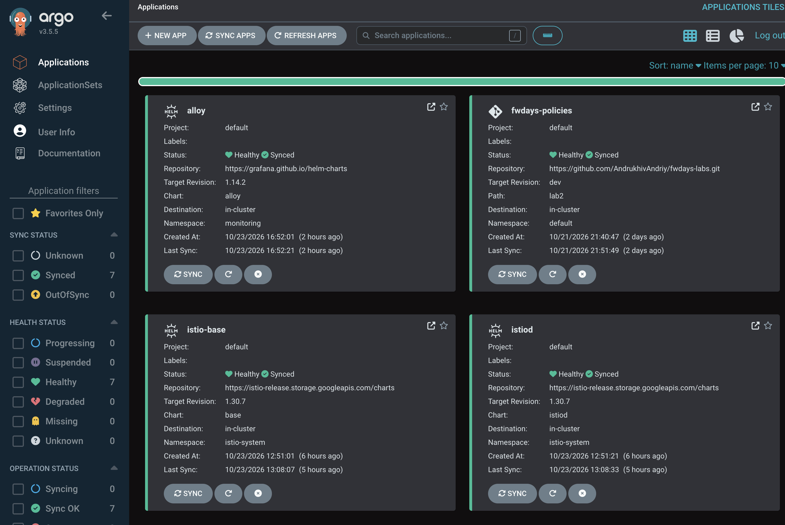
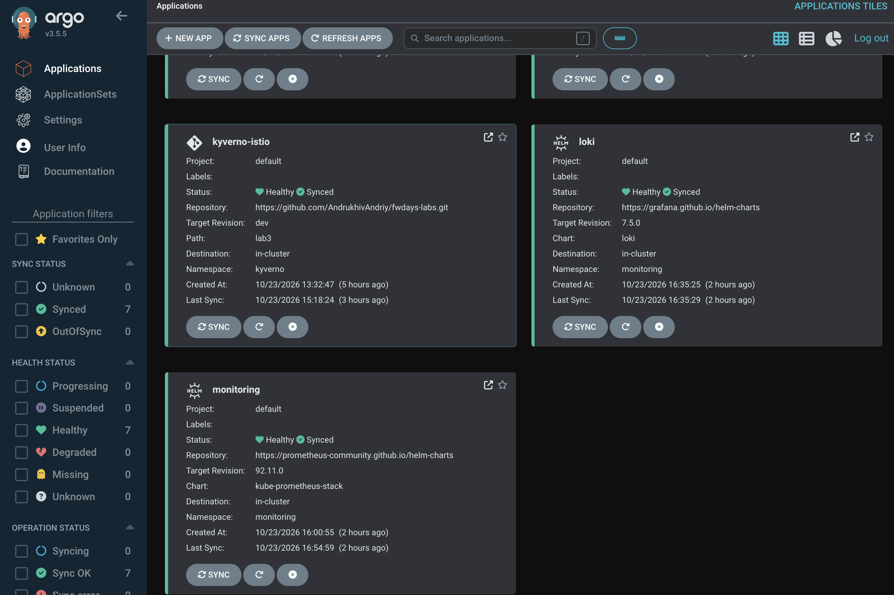
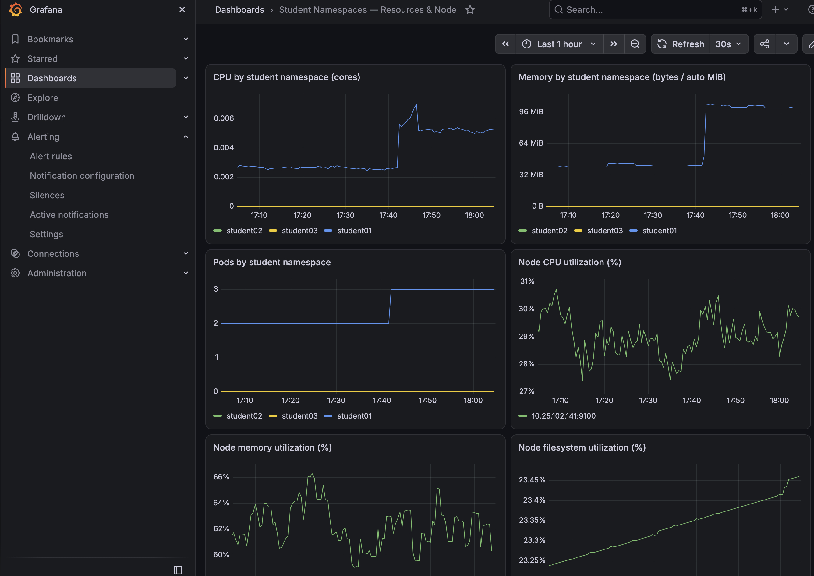
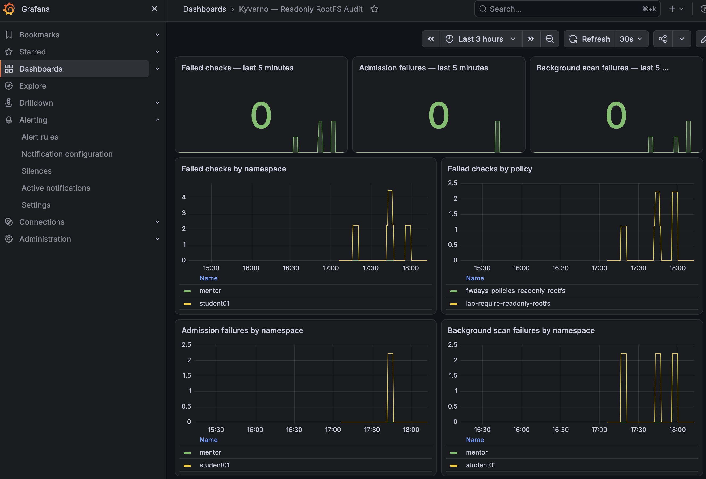
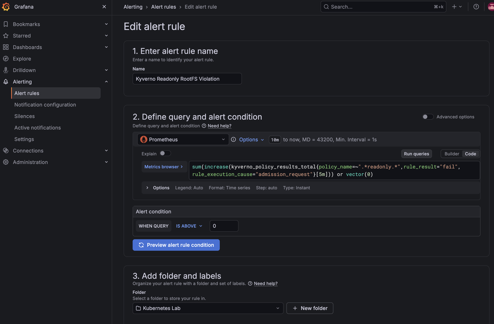
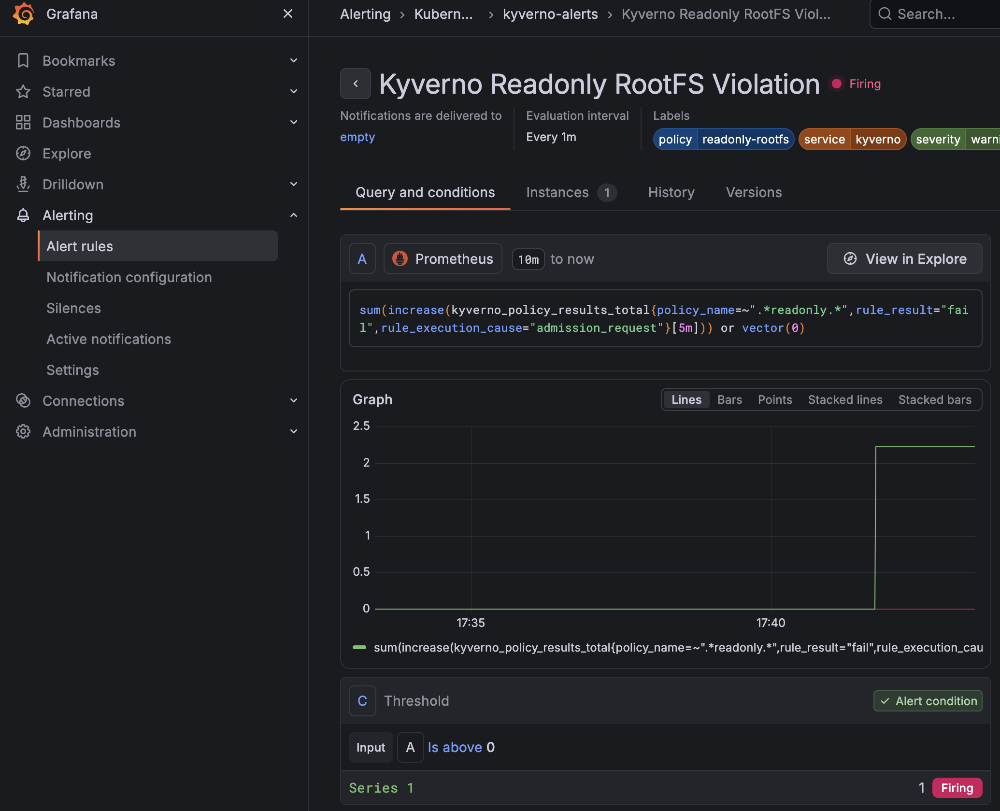

# Модуль 05 — Observability & Troubleshooting


> **Сховище Loki:** оскільки це лабораторна робота, використано ефемерний диск Kubernetes `emptyDir` (ліміт 2 GiB).

## 1. Встановлення Prometheus і Grafana

Argo CD Application `lab4/argocd/prometheus.yaml` встановлює `kube-prometheus-stack` у namespace `monitoring`. Для лабораторної задано Prometheus retention 2 доби, обмежені ресурси компонентів, вимкнено окремий Alertmanager і частину control-plane scraping, неактуальну для k3s. Для Prometheus та Grafana в цій конфігурації використано PVC.

```bash
kubectl apply -f lab4/argocd/prometheus.yaml
kubectl -n argocd get applications && kubectl -n monitoring get pods
```

**Фактичний результат перевірки:**

```text
NAME              SYNC STATUS   HEALTH STATUS
fwdays-policies   Synced        Healthy
istio-base        Synced        Healthy
istiod            Synced        Healthy
kyverno-istio     Synced        Healthy
monitoring        Synced        Healthy

NAME                                                   READY   STATUS    RESTARTS
monitoring-grafana-54459bfb64-qbmkv                    3/3     Running   0
monitoring-kube-prometheus-operator-849fc5d448-sgtr9   1/1     Running   0
monitoring-kube-state-metrics-764584797b-bmpbf         1/1     Running   0
monitoring-prometheus-node-exporter-v28g4              1/1     Running   0
prometheus-monitoring-kube-prometheus-prometheus-0     2/2     Running   0
```


## 2. Дашборд ресурсів студентських namespaces

Створено JSON-дашборд `student-resources.json`. Панелі відображають CPU, RAM і кількість Pod для `student01`, `student02`, `student03`, а також ресурси вузла. Для порожніх namespaces у PromQL передбачено нульові значення на основі `kube_namespace_created`.




## 3. Встановлення Loki та Alloy

Argo CD Applications:

```bash
kubectl apply -f lab4/argocd/loki.yaml
kubectl apply -f lab4/argocd/alloy.yaml
kubectl -n argocd get application loki
kubectl -n argocd get application alloy
kubectl -n monitoring get pods
```

Loki працює у режимі **SingleBinary**, з filesystem storage на `emptyDir`, без PVC. Alloy працює як **DaemonSet** - `http://loki.monitoring.svc.cluster.local:3100/loki/api/v1/push`.

**Фактичні результати:**

```text
NAME   SYNC STATUS   HEALTH STATUS
loki   Synced        Healthy
loki-0   2/2   Running   0   13m

NAME    SYNC STATUS   HEALTH STATUS
alloy   Synced        Healthy
alloy-g8pvb   2/2   Running   0   2m49s
```

У логах Alloy підтверджено відкриття потоків:

```text
level=info msg="opened log stream" component_id=loki.source.kubernetes.pods target=kyverno/kyverno-reports-controller-c69bfbdc6-96cxl:controller
level=info msg="opened log stream" component_id=loki.source.kubernetes.pods target=student01/istio-test:istio-proxy
```

Перевірка API Loki:

```bash
kubectl -n monitoring port-forward svc/loki 3100:3100
curl -s http://localhost:3100/loki/api/v1/labels | jq
```

**відповідь:**

```json
{
  "status": "success",
  "data": ["container", "instance", "job", "namespace", "node", "pod", "service_name"]
}
```

Запит логів Kyverno:

```bash
curl -sG 'http://localhost:3100/loki/api/v1/query_range' --data-urlencode 'query={namespace="kyverno"}' --data-urlencode 'limit=5' --data-urlencode 'since=1h'
```

**Фактичний результат:** `status: success`; повернуто потоки `kyverno-admission-controller`, `kyverno-cleanup-controller`, `kyverno-background-controller` з текстовими повідомленнями. Отже, доставка логів **Alloy → Loki** перевірена. Loki додано як Data Source у Grafana з адресою `http://loki.monitoring.svc.cluster.local:3100`.

## 4. Моніторинг аудиту Kyverno

Kyverno перевіряє `readOnlyRootFilesystem` у режимі `Audit`. Результати поточного стану ресурсів зберігаються в `PolicyReport`. Для сповіщення про **нові невдалі admission-перевірки** використано нативні метрики Kyverno, без CronJob та exporter.

### 4.1. ServiceMonitor

Файл `lab4/kyverno-servicemonitor.yaml`:

Prometheus використовує `serviceMonitorSelector.matchLabels.release=monitoring` і шукає ServiceMonitor у всіх namespaces. 

** 4 серії, кожна зі значенням `1`:**

```text
job="kyverno-reports-controller-metrics"      1
job="kyverno-background-controller-metrics"   1
job="kyverno-svc-metrics"                     1
job="kyverno-cleanup-controller-metrics"      1
```

Prometheus отримує **21 тип метрик Kyverno**, зокрема `kyverno_policy_results_total`. Для політик readonly виявлено **7 серій** із мітками `policy_name`, `resource_namespace`, `rule_result`, `rule_execution_cause`, `rule_name`.

Приклади **фактичних накопичувальних значень** (не кількість унікальних порушень):

```text
policy=fwdays-policies-readonly-rootfs, namespace=mentor,    cause=background_scan,   result=fail → 48
policy=fwdays-policies-readonly-rootfs, namespace=student01, cause=background_scan,   result=fail → 54
policy=lab-require-readonly-rootfs,    namespace=mentor,    cause=background_scan,   result=fail → 50
policy=lab-require-readonly-rootfs,    namespace=student01, cause=background_scan,   result=fail → 56
policy=fwdays-policies-readonly-rootfs, namespace=student01, cause=admission_request, result=fail → 1
policy=lab-require-readonly-rootfs,    namespace=mentor,    cause=admission_request, result=fail → 1
policy=lab-require-readonly-rootfs,    namespace=student01, cause=admission_request, result=fail → 2
```

### 4.3. Дашборд аудиту

Імпортовано `kyverno-readonly-rootfs.json`. Він відображає результати перевірок readonly root filesystem за namespace, політикою та типом виконання (`admission_request` / `background_scan`).




## 5. Grafana Alert: Kyverno Readonly RootFS Violation

У **Grafana → Alerting → Alert rules → New alert rule** створено правило:

| Параметр | Значення |
|---|---|
| Назва | `Kyverno Readonly RootFS Violation` |
| Data source | Prometheus |
| Folder | `Kubernetes Lab` |
| Evaluation group | `kyverno-alerts` |
| Evaluation interval | `1m` |
| Pending period | `None` |
| Keep firing for | `None` |
| Condition | `Reduce: Last` → `Threshold: IS ABOVE 0` |
| Labels | `severity=warning`, `service=kyverno`, `policy=readonly-rootfs` |
| Alertmanager | Вбудований `grafana` |



### Перевірка спрацювання

Створено тестовий Pod без `securityContext.readOnlyRootFilesystem: true`:

```bash
kubectl -n student01 run readonly-alert-test --image=nginx:alpine --restart=Never
```

**Фактичний результат PromQL:**

```text
Result series: 1
{}
2.2222222222222223
```

Оскільки значення перевищило `0`, Grafana перевела правило у стан **`Firing`** — це підтверджено під час тесту.


